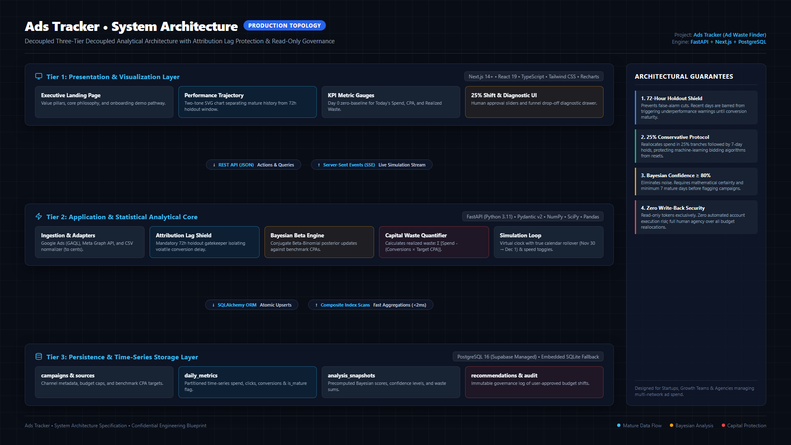

# Ads Tracker (Live Ad Campaign Waste Tracker)

[](https://vercel.com/new)


**Ads Tracker** is an evidence-based, read-only advertising analytics and financial guardrail platform designed for marketing teams, founders, and growth agencies. It protects marketing capital across Google Ads, Meta Ads (Facebook/Instagram), and other channels by isolating true ad waste with Bayesian statistical certainty while shielding against premature cuts caused by delayed attribution lag.

---

## 🚀 Key Features

* **🛡️ 72-Hour Attribution Lag Shield:** Enforces a mandatory rolling 3-day holdout window. Immature, volatile conversion data is visually shaded and barred from triggering premature panic cuts.
* **📊 Bayesian Beta-Binomial Classification:** Replaces naive thresholds with conjugate Bayesian probability distributions, ensuring campaigns are only flagged as *Underperforming* when statistical confidence exceeds $\ge 80\%$ over at least 7 mature days.
* **🔄 25% Conservative Shift Protocol:** Recommends safe, incremental 25% budget reallocations from chronically underperforming campaigns to proven winners or offline cash reserves, preventing machine-learning bidding algorithms from resetting.
* **🩺 On-Demand Funnel Diagnostics:** Diagnoses underlying conversion bottlenecks across ad creative (CTR), audience saturation (CPC), and landing page UX (CVR) before campaigns are abandoned.
* **⏱️ Virtual Simulation Engine:** Includes an interactive time-travel simulation engine featuring authentic calendar date rollovers (e.g., Nov 30 $\to$ Dec 1), speed controls (1x, 2x), and a strict Day 0 zero baseline.
* **🔒 Read-Only Zero Write-Risk:** 100% human-in-the-loop governance with zero write-back account mutation permissions, eliminating third-party automation bot liability.

---

## 🏛️ System Architecture

The application adopts a decoupled three-tier architecture:

1. **Presentation Layer:** Next.js 14+ / React 19, TypeScript, Tailwind CSS, Recharts, and Lucide Icons. Includes the executive landing page, live telemetry dashboard, and two-tone Performance Trajectory Canvas.
2. **Application & Statistical Engine:** FastAPI (Python 3.11), Pydantic v2, NumPy, SciPy, and Pandas for vectorized Bayesian updating and Server-Sent Events (SSE) streaming.
3. **Persistence Layer:** PostgreSQL 16 (Supabase managed) with time-series indexing and composite keys, backed by embedded SQLite fallback.



---

## 📁 Repository Structure

```
Ads-Tracker/
├── index.html                 # Complete standalone production web application
├── vercel.json                # Vercel zero-config static deployment routing
├── architecture_diagram.png   # High-resolution 1080p architecture blueprint
├── architecture_diagram.html  # Interactive architecture canvas source
│
├── frontend/                  # Next.js 14 / TypeScript React web client
│   ├── src/                   # React components, hooks & state
│   ├── package.json           # Frontend dependencies
│   └── tailwind.config.ts     # Design tokens & themes
│
├── backend/                   # FastAPI Python asynchronous API
│   ├── main.py                # ASGI application entrypoint
│   ├── adapters/              # Google Ads GAQL & Meta Graph API parsers
│   ├── analysis/              # Bayesian Beta-Binomial core & waste logic
│   ├── simulator/             # Virtual time-travel clock generator
│   └── requirements.txt       # Python dependencies
│
├── docs/ & Milestones/        # Complete academic & engineering specifications
│   ├── Milestone 1.pdf        # Requirement Analysis & Architectural Design
│   ├── Milestone 2.pdf        # Core Module Implementation & Prototyping
│   ├── Milestone 3.pdf        # Integration & Intermediate Evaluation
│   ├── Milestone 4.pdf        # Comprehensive Testing & Optimization
│   └── Milestone 5.pdf        # Deployment, Final Documentation & Viva Preparation
│
├── design-system.md           # Visual style & UI component guide
├── product-design.md          # Complete functional specification & logic
└── server.ps1                 # Local lightweight HTTP daemon
```

---

## ⚡ Quickstart: Local Setup

### Option 1: Instant Standalone (Zero Dependencies)
You can launch the complete responsive application with the bundled PowerShell HTTP server:

```powershell
# Clone the repository
git clone https://github.com/croxy6801/Ads-Tracker.git
cd Ads-Tracker

# Run the local server on port 3000
powershell -ExecutionPolicy Bypass -File server.ps1 -port 3000

# Open in your browser:
http://localhost:3000/
```

### Option 2: Full-Stack Development Setup

#### 1. Backend (FastAPI)
```bash
cd backend
python -m venv venv
source venv/bin/activate  # On Windows: .\venv\Scripts\activate
pip install -r requirements.txt
uvicorn main:app --reload --port 8000
```

#### 2. Frontend (Next.js)
```bash
cd frontend
npm install
npm run dev
```

---

## 🌐 Deploy to Vercel

This repository is pre-configured with `vercel.json` for instant, zero-build deployment:

1. Fork or push this repository to your GitHub account.
2. Log in to [Vercel](https://vercel.com/).
3. Click **Add New Project** and select **Ads-Tracker**.
4. Click **Deploy**. Vercel will instantly publish the live web application on a public `.vercel.app` domain!

---

## 📑 Milestone Deliverables

Comprehensive PDF documentation covering every phase of the engineering lifecycle is included directly in the root directory:
* [Milestone 1: Requirement Analysis & Architectural Design](Milestone%201.pdf)
* [Milestone 2: Core Module Implementation & Prototyping](Milestone%202.pdf)
* [Milestone 3: Integration & Intermediate Evaluation](Milestone%203.pdf)
* [Milestone 4: Comprehensive Testing & Optimization](Milestone%204.pdf)
* [Milestone 5: Deployment, Final Documentation & Viva Preparation](Milestone%205.pdf)

---

## 📜 License
Distributed under the MIT License. See `LICENSE` for more information.
